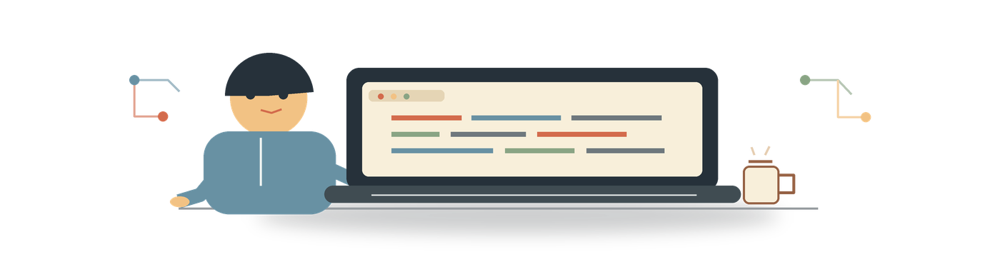
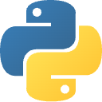

  <h1>itsmarcos</h1>
  

### O que eu construo

| Linguagem | Conexão com o que eu construo |
| --- | --- |
| | Sistemas de IA, automação local e ferramentas práticas. |
| | Interfaces web e experiências interativas. |
| | Estrutura clara para produtos e ferramentas na web. |
| | Interfaces cuidadas, legíveis e funcionais. |

### Projetos selecionados

- [Nexo](https://github.com/marcosbuilds/nexo) é um trabalhador digital público para contexto, memória, decisões e ação.

### Foco

IA aplicada · automação local · avaliação de modelos · interfaces web

