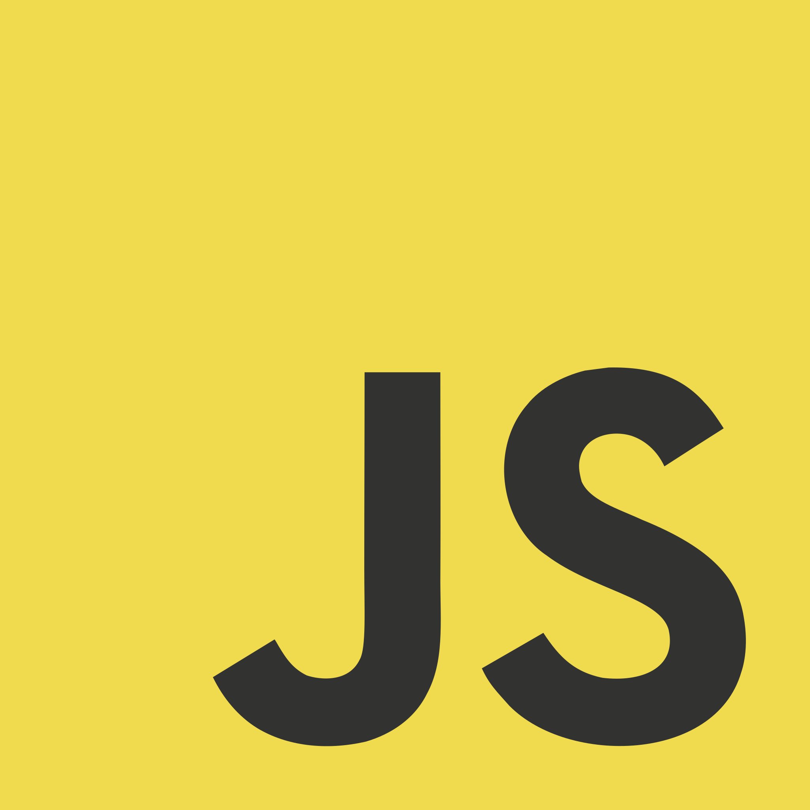
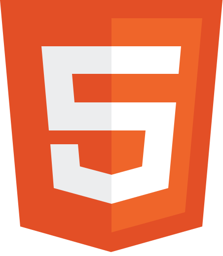
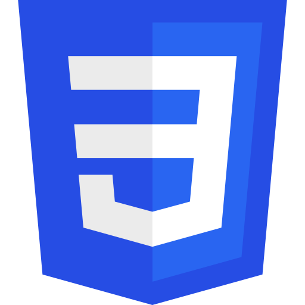

  &nbsp;&nbsp;&nbsp;
  &nbsp;&nbsp;&nbsp;
  &nbsp;&nbsp;&nbsp;
  
   
  <b>Python</b>&nbsp;&nbsp;&nbsp;&nbsp;&nbsp;&nbsp; <b>JavaScript</b>&nbsp;&nbsp;&nbsp;&nbsp;&nbsp;&nbsp; <b>HTML</b>&nbsp;&nbsp;&nbsp;&nbsp;&nbsp;&nbsp; <b>CSS</b>

<h1 align="center">itsmarcos</h1>

I build practical tools with Python and the web.

Local automation, AI systems, model evaluation, and web interfaces.

## Projects

- [Nexo](https://github.com/marcosbuilds/nexo) is a public digital worker for context, memory, decisions, and action.
- [Portfolio](https://marcosbuilds.github.io/Portfolio/) is my personal web project. The source code is private.

## Languages

Python is the language I use most across my repositories. I also work with HTML, JavaScript, and CSS for web interfaces.
